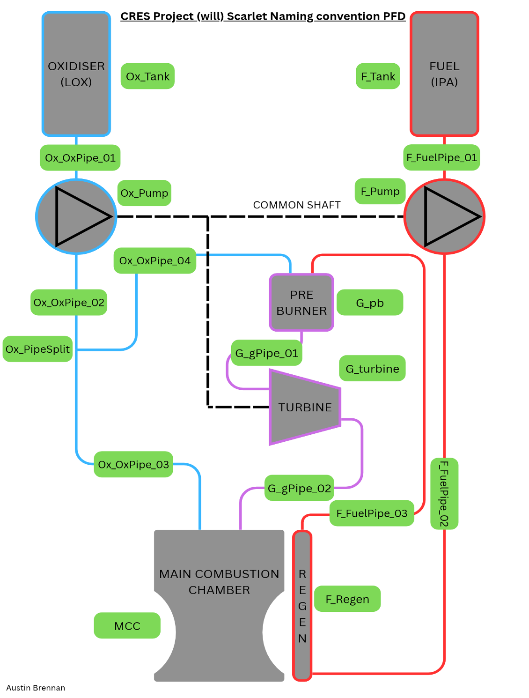

# Code Structure:

## Functions
```py
def name(
    parameter1,
    parameter2
):

print("This is an example!")
```

## Variables & Naming Conventions

Variables will be names that we all understand as a team.

We will also be using the naming conventions from the diagrams, like Ox_Tank.

Here is the diagram for reference:


## Git Commits

Git Commit names should not be way too long. Keep it short-medium sized.

When it comes to coding/documentation, commit as frequently as possible, even little lines of code, comments and/or documentation. 

## Pull Requests and Branches (?)
This will be thought of later, since we are all students, so we all have limited time. Coursework and Exams **never** wait for anyone. Whether everyone is willing to learn git commands, I (James) wouldn't mind teaching.